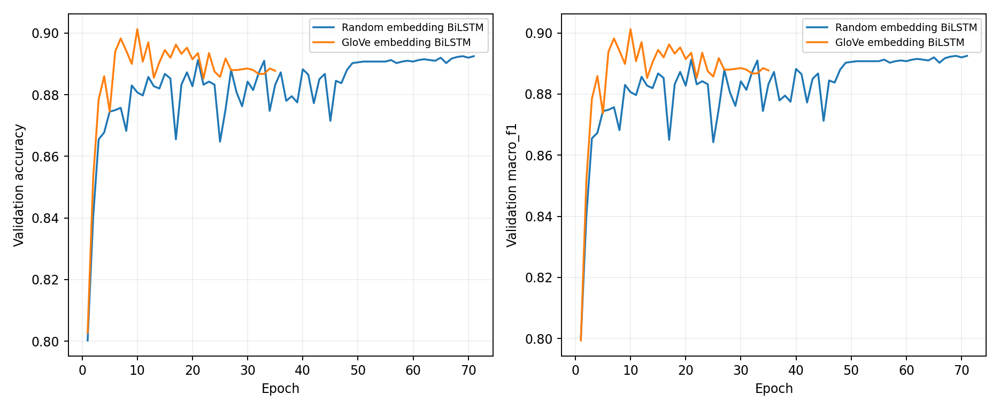
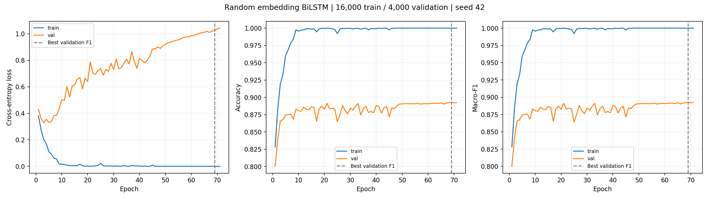
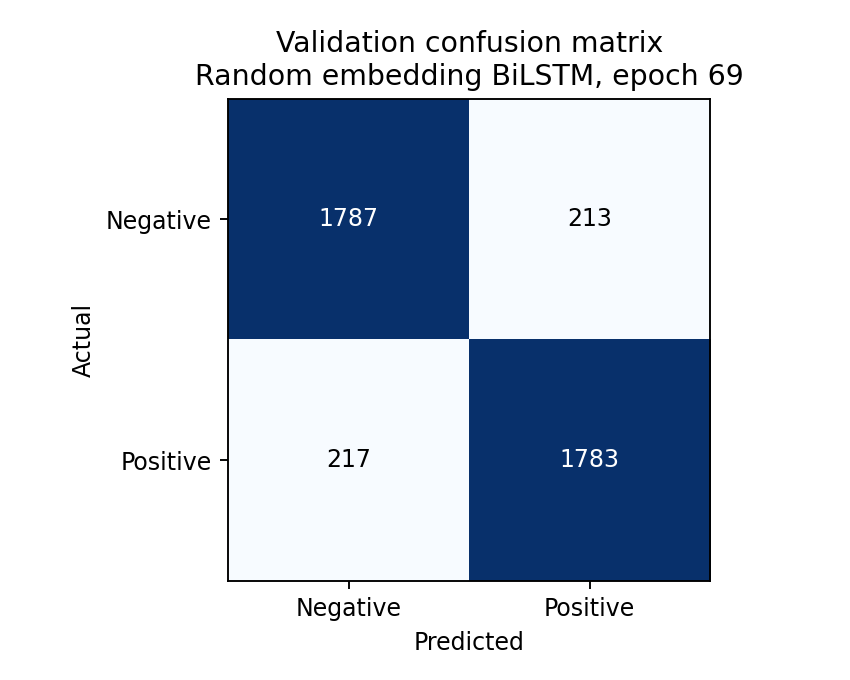
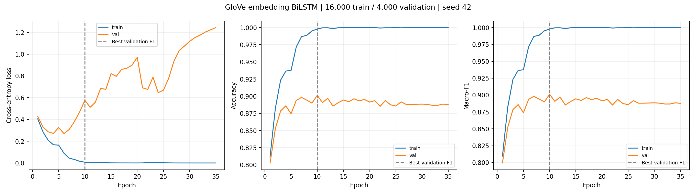
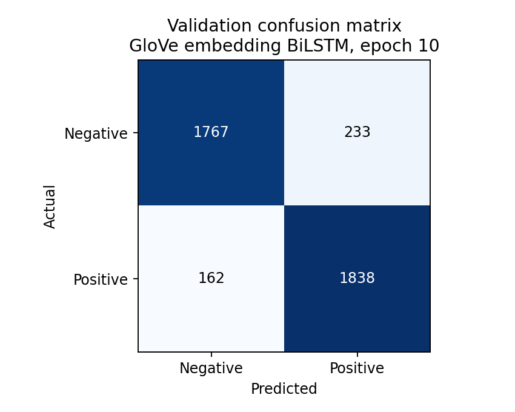

# LSTM: two separate extended-training experiments

The planned maximum was 100 epochs per model. At the user request, training was manually stopped after satisfactory validation performance: random embeddings completed 71 epochs and GloVe completed 35. This was not a predefined patience-based stopping rule. The directory name lstm_100 records the original plan, not the actual number of completed epochs.

Both models use the same cleaned 16,000 training and 4,000 validation examples (seed 42). The official test split was not evaluated in these runs. GloVe initializes word embeddings and is fine-tuned; the recurrent classifier is trained from scratch.

Shared settings: embedding dimension 100, hidden dimension 128 per direction, dropout 0.3, batch size 128, maximum sequence length 256, AdamW learning rate 0.001. Vocabulary is built from training data only. Best checkpoints are selected by validation Macro-F1, not by the last epoch.

| Model | Completed epochs | Best epoch | Validation accuracy | Macro precision | Macro recall | Macro-F1 | Wall time |
|---|---:|---:|---:|---:|---:|---:|---:|
| random | 71 | 69 | 89.25% | 89.25% | 89.25% | 89.25% | 10.2 min |
| glove | 35 | 10 | 90.12% | 90.18% | 90.12% | 90.12% | 5.1 min |

## Validation comparison

## Random BiLSTM

Best validation Macro-F1 occurs at epoch 69. Last completed epoch (71) validation Macro-F1: 89.25%; training accuracy: 100.00%.

Training curves report evaluation-mode metrics on the training and validation splits after each epoch. Dashed lines mark the best validation epoch. Confusion matrices use validation data only.

## Glove BiLSTM

Best validation Macro-F1 occurs at epoch 10. Last completed epoch (35) validation Macro-F1: 88.77%; training accuracy: 100.00%.

Training curves report evaluation-mode metrics on the training and validation splits after each epoch. Dashed lines mark the best validation epoch. Confusion matrices use validation data only.

## Download checkpoints

- [random best checkpoint, metrics and figures](https://github.com/yancanbethebest/comp7015-yelp-sentiment/releases/download/lstm-extended-2026-10-31/random_lstm_extended.tar.gz); SHA-256: `2079cb6f2663774adf31eab49f3a4181afed507071f6293602e20b8944356af3`.
- [glove best checkpoint, metrics and figures](https://github.com/yancanbethebest/comp7015-yelp-sentiment/releases/download/lstm-extended-2026-10-31/glove_lstm_extended.tar.gz); SHA-256: `de944737717100f8b41fae2aeec41f3602e7a2e0beaf23eb36ef8308e5935840`.

GloVe reached its best validation F1 at epoch 10 and did not improve in the next 25 completed epochs. Random embeddings showed a small late improvement, reaching their best at epoch 69. Both achieved near-perfect training accuracy while validation performance remained lower, indicating overfitting. GloVe improved best validation F1 by approximately 0.87 percentage points.

These are extended training experiments, not a complete hyperparameter study or a final test-set comparison. Wall time includes training and evaluation, and the experiments overlapped on the same GPU; these durations are not a controlled compute-cost benchmark. All completed epochs are retained to show training dynamics; more epochs do not guarantee better validation performance.
