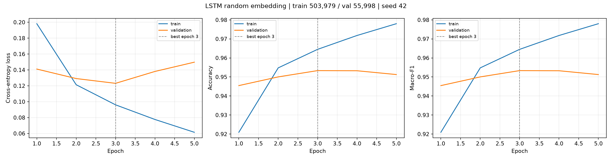
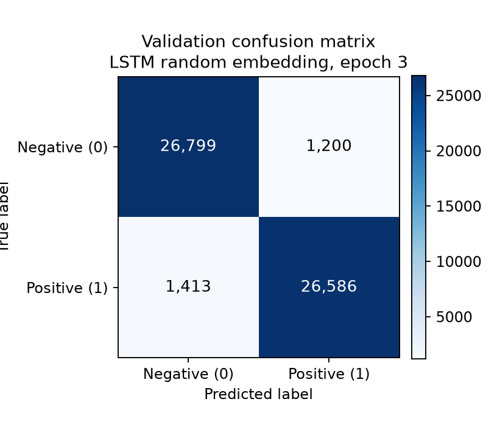

# Model card — member2_bilstm_random_full_seed42

- 架构 / architecture: Bidirectional **LSTM** with randomly initialised embeddings
- Embedding: random U(-0.1, 0.1), trainable (`embedding_dim=100`)
- 隐藏层 / hidden: 128 per direction × 1 layer(s), bidirectional=True, pooling=`last`
- Dropout: 0.3 (recurrent output) / 0.1 (embedding)
- 参数量 / parameters: **3,236,034**
- 词表 / vocabulary: 30,000 ids (PAD=0, UNK=1), fitted on the training split only
- 截断长度 / max_len: 256 tokens
- 数据 / data: train 503,979 / val 55,998 / test 38,000（全量清洗划分，seed=42，由成员一固定）
- 优化 / optimisation: AdamW lr=0.001, weight_decay=0.01, batch=128, grad_clip=1.0
- 早停 / early stopping: enabled=True, patience=4, min_delta=0.0005（监控验证 Macro-F1）
- 完成轮数 / epochs: 5（预算 5，停止原因 `max_epochs`）
- 最佳轮次 / best epoch: **3**

## Validation performance (best epoch)

| Metric | Value |
|---|---:|
| Accuracy | 0.9533 |
| Macro Precision | 0.9534 |
| Macro Recall | 0.9533 |
| Macro-F1 | **0.9533** |
| Loss | 0.1231 |
| Class 0 — P / R / F1 | 0.9499 / 0.9571 / 0.9535 |
| Class 1 — P / R / F1 | 0.9568 / 0.9495 / 0.9532 |

## Confusion matrix (validation)

| | Predicted negative | Predicted positive |
|---|---:|---:|
| **True negative** | 26,799 | 1,200 |
| **True positive** | 1,413 | 26,586 |

## Training cost

| Item | Value |
|---|---:|
| GPU | NVIDIA GeForce GTX 1650 with Max-Q Design |
| PyTorch / CUDA | 2.6.0+cu124 / 12.4 |
| Epochs completed | 5 |
| Seconds per epoch | 567.0 |
| Total wall time | 47.3 min |
| Peak GPU memory (MB) | 248.2 |
| AMP | True |

## Figures

## Notes / limitations

- 单种子结果，未做多种子方差分析。
- `max_len=256` 会截断约 19% 的评论，长评论可能因此判错。
- 随机初始化 embedding 不含外部语言知识；这正是成员三 GloVe/Word2Vec 组的比较目标。
- 验证集只用于选模与早停；测试集未参与训练与选模。
