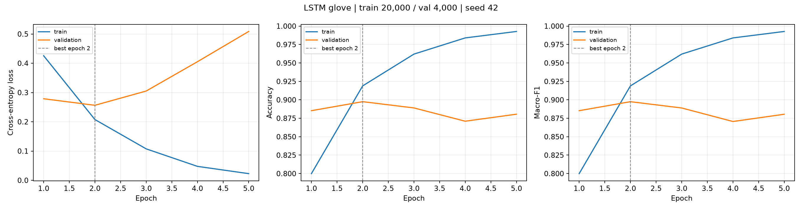
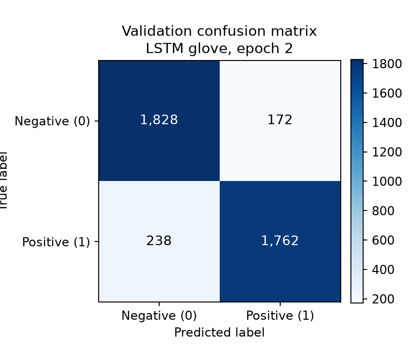

# Model card — member3_best_glove_finetuned_20k_seed42

- 架构 / architecture: Bidirectional **LSTM**
- Embedding source: **glove**（fine-tuned）
- 预训练词表覆盖率 / coverage: **0.8357**
- Embedding dim: 100, hidden: 256 per direction
- Dropout: 0.3 / embedding 0.1
- 参数量 / parameters: **3,734,210**
- 词表 / vocabulary: 30,000 ids (PAD=0, UNK=1)
- 截断长度 / max_len: 128
- 数据 / data: train 20,000 / val 4,000 / test 38,000
- 优化 / optimisation: AdamW lr=0.002, batch=32
- 最佳轮次 / best epoch: **2**

## Validation performance (best epoch)

| Metric | Value |
|---|---:|
| Accuracy | 0.8975 |
| Macro Precision | 0.8979 |
| Macro Recall | 0.8975 |
| Macro-F1 | **0.8975** |

## Figures

