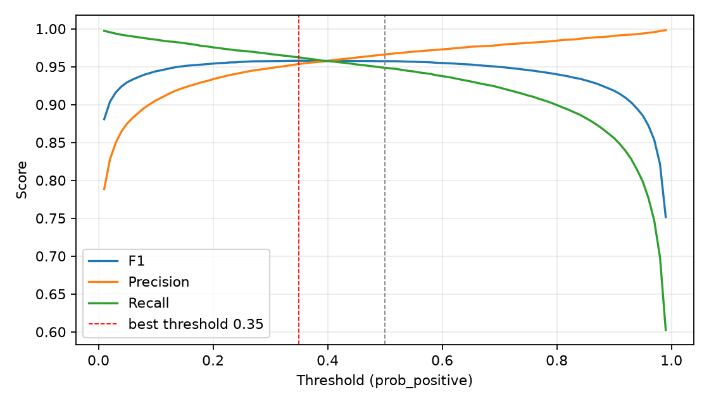
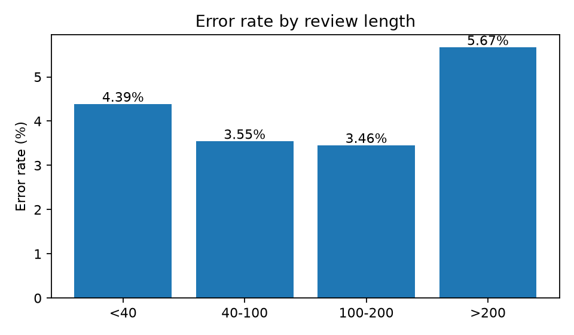
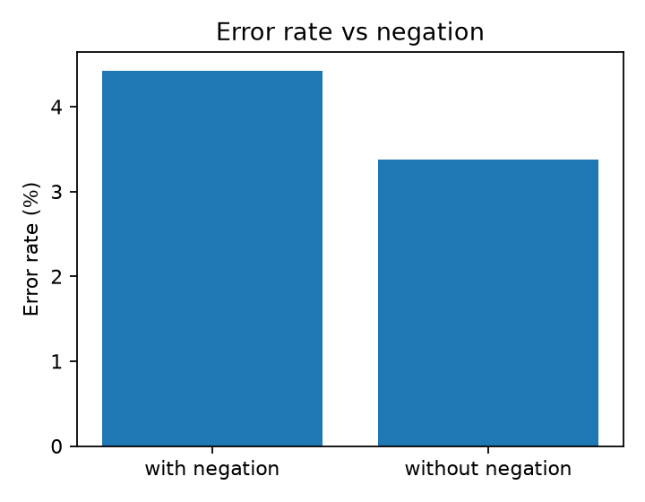

# 错误分析与阈值校准

- 模型：best_model.pt
- 数据：val，共 55,998 条，max_len=256
- 总体：Accuracy 95.77%，Macro-F1 95.77%
- 混淆矩阵（行=真实，列=预测）：[[27072, 927], [1442, 26557]]

## 1. 按评论长度分桶

| 长度 | 样本数 | 错误率 |
|---|---:|---:|
| <40 | 7,313 | 4.39% |
| 40-100 | 16,300 | 3.55% |
| 100-200 | 16,544 | 3.46% |
| >200 | 15,841 | 5.67% |

## 2. 否定词

| 类别 | 样本数 | 错误率 |
|---|---:|---:|
| 含否定词 | 45,795 | 4.42% |
| 不含否定词 | 10,203 | 3.37% |

## 3. 按置信度分桶

| 置信度 | 样本数 | 错误率 |
|---|---:|---:|
| high confidence (>0.3) | 52,323 | 2.08% |
| mid confidence (0.1-0.3) | 2,665 | 31.37% |
| low confidence (<0.1) | 1,010 | 44.16% |

## 4. 阈值校准

- 默认阈值 0.5：Macro-F1 95.77%
- 最佳阈值 0.35：Macro-F1 95.79%，Precision 95.35%，Recall 96.23%

