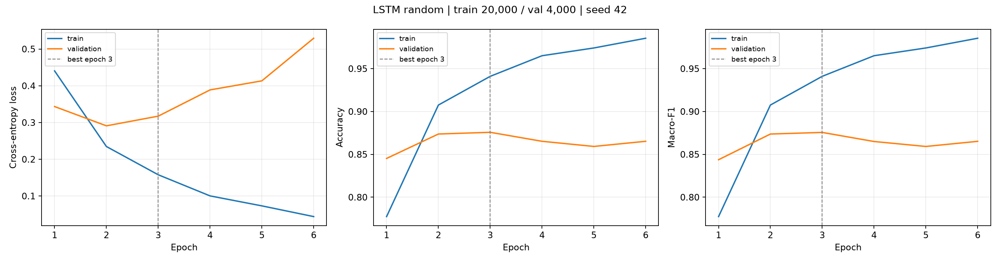
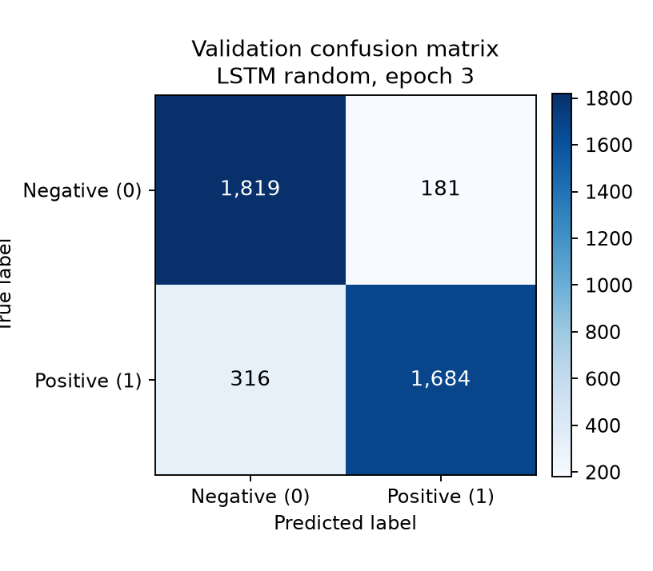

# Model card — member3_random_bilstm_20k_seed42

- 架构 / architecture: Bidirectional **LSTM**
- Embedding source: **random**（fine-tuned）
- Embedding dim: 100, hidden: 128 per direction
- Dropout: 0.3 / embedding 0.1
- 参数量 / parameters: **3,236,034**
- 词表 / vocabulary: 30,000 ids (PAD=0, UNK=1)
- 截断长度 / max_len: 128
- 数据 / data: train 20,000 / val 4,000 / test 38,000
- 优化 / optimisation: AdamW lr=0.001, batch=64
- 最佳轮次 / best epoch: **3**

## Validation performance (best epoch)

| Metric | Value |
|---|---:|
| Accuracy | 0.8758 |
| Macro Precision | 0.8775 |
| Macro Recall | 0.8758 |
| Macro-F1 | **0.8756** |

## Figures

